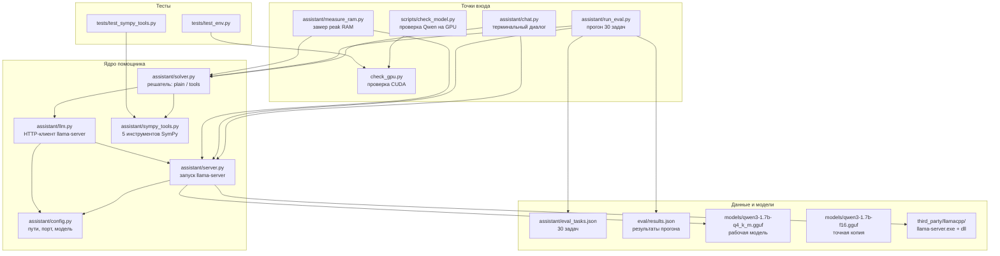

# Файлграф проекта kpack-lab

Локальный физмат-помощник: школьная математика и физика на русском.
Связка: Qwen3-1.7B (GGUF, CPU через llama.cpp) + точные вычисления через SymPy.
GPU-ветка (PyTorch + CUDA) — только для проверки базовой модели, в основной пайп не входит.

## Карта связей



## Что за что отвечает

| Файл | Роль | Что внутри | От кого зависит |
|---|---|---|---|
| [assistant/config.py](/C:/Users/Admin/kpack-lab/assistant/config.py) | Единые константы | Пути к `llama-server.exe` и GGUF-модели, хост/порт `127.0.0.1:8080`, контекст 2048, суффикс `/no_think` | Ни от кого |
| [assistant/server.py](/C:/Users/Admin/kpack-lab/assistant/server.py) | Жизненный цикл инференса | `start()` поднимает `llama-server.exe -m модель -c 2048`, ждёт `/health` до 120 с; `stop()` гасит процесс; `is_up()` — проверка | `config` |
| [assistant/llm.py](/C:/Users/Admin/kpack-lab/assistant/llm.py) | Разговор с моделью | POST на `/v1/chat/completions`, дописывает `/no_think` к юзер-промпту, возвращает текст ответа | `config` (URL, суффикс) |
| [assistant/sympy_tools.py](/C:/Users/Admin/kpack-lab/assistant/sympy_tools.py) | Точные вычисления, песочница | 5 инструментов (`solve_eq`, `simplify_expr`, `diff_expr`, `integrate_expr`, `check_substitute`); вход только строками ≤500 символов, белый список узлов SymPy, запрет `import/exec/eval/...`, таймаут 30 с; ошибки → строка `ERROR:...` | Только SymPy |
| [assistant/solver.py](/C:/Users/Admin/kpack-lab/assistant/solver.py) | Мозг: два режима решения | `plain`: один запрос к LLM со строгим форматом из 5 разделов. `tools`: фаза 1 — планировщик просит у LLM только ```toolcall-блоки (до 2 попыток), фаза 2 — `execute_tool` (макс 6 вызовов), фаза 3 — финальный ответ с разделом ПРОВЕРКА по результатам SymPy | `llm`, `sympy_tools` |
| [assistant/chat.py](/C:/Users/Admin/kpack-lab/assistant/chat.py) | Пользовательский вход | REPL-цикл `Задача>`, команды `/plain`, `/tools`, `/quit`; сам поднимает сервер, если не запущен, и гасит его при выходе | `server`, `solver` |
| [assistant/run_eval.py](/C:/Users/Admin/kpack-lab/assistant/run_eval.py) | Эксперимент plain vs tools | Гоняет все задачи из `eval_tasks.json` через оба режима `solver.solve`, оценивает `grade()` по секции `ОТВЕТ` (числа с допуском или `match_any`), пишет [eval/results.json](/C:/Users/Admin/kpack-lab/eval/results.json) + сводку по категориям | `server`, `solver`, `eval_tasks.json` |
| [assistant/measure_ram.py](/C:/Users/Admin/kpack-lab/assistant/measure_ram.py) | Замер памяти CPU-режима | Поднимает сервер, семплирует RSS сервера и Python через psutil каждые 0.2 с, решает одну задачу по теплоте, печатает peak RAM | `server`, `solver`, psutil |
| [assistant/eval_tasks.json](/C:/Users/Admin/kpack-lab/assistant/eval_tasks.json) | Датасет проверки | 30 задач: 10 школьная математика, 10 школьная физика, 5 высшая математика, 5 олимпиадные; поля `numbers`+`tol` или `match_any` | — |
| [eval/results.json](/C:/Users/Admin/kpack-lab/eval/results.json) | Артефакт прогона | 30 записей `{id, plain:{pass,time_s,answer}, tools:{...}}` | Пишется `run_eval.py` |
| [scripts/check_model.py](/C:/Users/Admin/kpack-lab/scripts/check_model.py) | GPU-проверка исходной модели | Грузит `Qwen/Qwen3-1.7B@70d244c` из `.hf-cache` через transformers на CUDA (BF16/FP16), генерирует ответ на `2+2`, печатает время и peak VRAM | torch, transformers, `MODEL_REVISION.txt` |
| [check_gpu.py](/C:/Users/Admin/kpack-lab/check_gpu.py) | Дым-тест GPU | Версия torch, `cuda.is_available`, matmul 512×512 на `cuda:0` | torch |
| [tests/test_sympy_tools.py](/C:/Users/Admin/kpack-lab/tests/test_sympy_tools.py) | Тесты песочницы | 8 тестов: корректность 5 инструментов + отказ на кодоподобных входах, плохих уравнениях и чужих аргументах | `sympy_tools` |
| [tests/test_env.py](/C:/Users/Admin/kpack-lab/tests/test_env.py) | Тесты окружения | Импорт torch/transformers/datasets/peft/accelerate, наличие CUDA, matmul на GPU | torch |
| [models/](/C:/Users/Admin/kpack-lab/models) | Веса GGUF | `qwen3-1.7b-q4_k_m.gguf` (~1.2 ГБ, рабочая, контекст 2048), `qwen3-1.7b-f16.gguf` (~4 ГБ, точная) | Используются `server.py` |
| [third_party/llamacpp/](/C:/Users/Admin/kpack-lab/third_party/llamacpp) | Рантайм инференса | `llama-server.exe` + ggml DLL, сборка b11476, CPU-only Windows | Запускается `server.py` |
| [third_party/conversion/ + gguf-py/](/C:/Users/Admin/kpack-lab/third_party/conversion) | Вендоренные конвертеры | `convert_hf_to_gguf.py` и библиотека `gguf-py` — разовая конвертация HF→GGUF, в рантайме не участвуют | — |
| [requirements.txt](/C:/Users/Admin/kpack-lab/requirements.txt) | Зависимости | torch (cu128), transformers, datasets, peft, accelerate, pytest, requests, sympy, psutil, gguf, sentencepiece | — |
| [MODEL_REVISION.txt](/C:/Users/Admin/kpack-lab/MODEL_REVISION.txt) | Пининг модели | `Qwen/Qwen3-1.7B`, ревизия `70d244c`, кэш `.hf-cache` | Читается человеком/`check_model.py` |

## Как что работает (три потока)

1. **Диалог** (`chat` → `server` → `solver` → `llm`/`sympy_tools`): пользователь вводит задачу → `solver.solve` либо сразу отвечает (plain), либо сначала просит у модели план вычислений в виде toolcall-блоков, выполняет их локально в SymPy-песочнице и подсовывает результаты модели для финального ответа по шаблону ДАНО / МЕТОД / РЕШЕНИЕ / ПРОВЕРКА / ОТВЕТ.
2. **Оценка** (`run_eval` → `solver` × 2 режима → `results.json`): каждая из 30 задач решается дважды, `grade()` сверяет секцию ОТВЕТ с эталоном и считает pass/format_ok/время; итог — таблица точности plain vs tools по категориям.
3. **GPU-ветка** (`check_gpu`, `check_model`, `test_env`): отдельно от основного CPU-пайпа проверяет, что PyTorch видит RTX 4060 и тянет оригинальный Qwen3-1.7B; на боевой инференс не влияет.

## Узловые файлы (год-ноды)

- `assistant/solver.py` — через него идут все решения (чат, эвал, замер RAM).
- `assistant/server.py` — единолично владеет процессом `llama-server`.
- `assistant/sympy_tools.py` — единственное место точной математики и единственное, что покрыто содержательными тестами.
- `assistant/config.py` — все пути и порт; смена модели/порта делается здесь.
